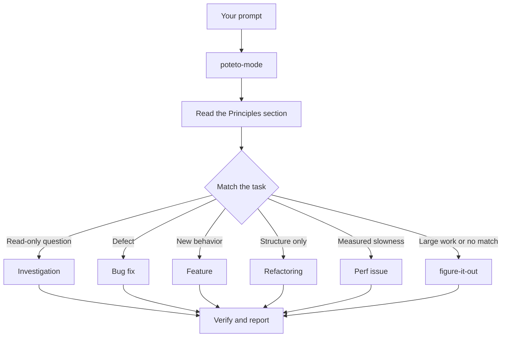

# 经 `/poteto-mode` 路由工作

`/poteto-mode` 是入口。你给它一个目标，它从二十二个 playbook 里匹配一个，把那个 playbook 的步骤抄进待办，并在步骤需要时调用其他 skill。本页讲好的 prompt 长什么样，以及你其实需要写得多短。


## prompt 会怎样



图里是常见路线。还有这些 playbook：对一项指标做 hillclimb，诊断运行时症状和抓下来的 trace，原型，视觉对齐，编写和评估 skill，自主运行，开 PR，把 PR 或 stack 看护到可合并，交付一个已验证的 stack，用 autopilot 跑一队列 PR 或一个 stack，接手会话，安全暂停，多阶段计划，以及清理 worktree。[playbook 目录](../../skills/poteto-mode/playbooks/) 是全套。

## 说目标，别走形式

你不用写规格。说出哪里坏了，或你想要什么，再加上你已经知道、能省掉 agent 时间的事：

```text
/poteto-mode users get two notifications after a retry. repro first, then fix and verify.
```

这是一条修 bug 的 prompt。「先复现」是真正的约束，不是客气，playbook 会照做。看修 bug 的步骤填进待办。

## prompt 里写什么

一条有用的 prompt 最多带五样东西，每样一句话：

- **目标。** 说出哪里错了，或你要什么。
- **做完的检查。** 它必须能过能败。「弄好一点」和「做一小时」都不是检查。
- **你想看到的证明。** 要真实的命令输出、流程的视频、存下的值，或一个前后数字。
- **你已经知道的。** 一个症状、一步复现、一行日志或一条链接，能省掉 agent 一次搜索。
- **真正的约束。** 「先复现」「先别改任何代码」「行为零变化」「继续之前让我评审」，每一条都会改变 agent 做什么。

下面是五样都有的一条：

```text
/poteto-mode the csv export drops its last row since yesterday's deploy. failing job id is 4812. repro first, then fix. done means the 60k-row fixture exports every row. show me the row counts before and after.
```

有两样值得留在外面：

- **怎么做。** 说要达成什么，给 agent 留出找到更好办法的余地。罗列 skill 也一样，下面的坑会讲。
- **你对原因的猜测，先别说。** 说出来的猜测会把搜索收窄到你指的地方。先让 agent 重述问题，再分享你的直觉。

报告很吵时，比如一条长讨论或一个含糊的 bug，把重述当成第一步：

```text
/poteto-mode read this thread. restate the underlying issue in your own words, in plain english. don't change any code yet.
```

误读会出现在重述里，那时还没有任何代码。在那里纠正，代价是一条消息，不是一次改错。只要重述、不要 playbook 时，跑 [`/in-your-own-words`](../../skills/in-your-own-words/SKILL.md)。它重述 agent 认为你的目标是什么、你在解决什么问题。

拿不准 prompt 是否对准时，发出去之前先对它跑 [`/sharpen`](../../skills/sharpen/SKILL.md)：

```text
/sharpen write a migration guide for the v2 config format.
```

agent 会说出顶尖的人会做、而你没开口要的事，他们从什么原材料起步，他们的方法和工具，以及除了你或 agent 之外，什么能表明结果是对的。然后它改写你的 prompt，正好去要这些，更深，但并不更大。改写要求 agent 把实验能定的选择先做成原型，并根据观察到的结果推荐一个选项，产品和偏好上的选择留给你。它不做这个任务。读完改写再发出去，例如配上 `/poteto-mode`。

叫不出你要的东西叫什么时，先对自己的描述和文件跑 [`/reframe`](../../skills/reframe/SKILL.md)：

```text
/reframe the settings page saves some fields right away and others only on submit, and people lose edits.
```

agent 给出 8 到 12 个专家术语，按每一个会在多大程度上改变你要做的东西来排序。每一个都带上它点名的那段描述、一个那样使用它的真实项目（链接已核对），以及它让你能向 agent 开口要什么。它也从 2 到 3 个用别的名字解决了同一问题的相邻领域借术语，并说出每个类比在哪里断开。然后用这些新词改写你的描述。把改写发出去，或者先对它跑 `/sharpen`。

## 短跟进

聊天里已经装着上下文时，prompt 可以缩到几乎没有。下面这些都够：

```text
/poteto-mode do it
```

```text
continue
```

```text
keep going until done
```

短能用，是因为 playbook 撑着结构，自定义模式又让 `/poteto-mode` 每一轮都留在上下文里。[设置 pstack](./01-setup.md#run-your-first-task) 讲怎么开一个。你的话带意图，skill 带严谨。

## 用「新任务」换任务

长聊天会攒上下一个任务的上下文。换主题时要说出来：

```text
/poteto-mode new task. figure out why the cache entry survives logout. don't change any code yet.
```

「新任务」让 `/poteto-mode` 重新匹配，而不是接着上一个 playbook。「先别改任何代码」把这一次钉在调查上。没有这两句，功能做到一半的模式往往会把你的问题当成下一步功能。

## 并行的工作各给一台机器

几台 agent 在同一台电脑、同一个仓库上干活，会抢工作区、端口和构建产物。最干净的隔离是[云 subagent](https://cursor.com/docs/subagents#cloud-subagents)。每台有自己的虚拟机和分支，可以装依赖、跑你的应用、给结果录像，而不碰你的机器。在任务前输入 `/in-cloud`，或让父聊天把工作交给云 subagent。

工作必须留在本地时，事先要一个 worktree：

```text
/poteto-mode new task. branch off <base> in a fresh worktree, then port the parser change there.
```

每个任务自己的分支和 worktree，agent 就不会踩到彼此的文件。worktree 占磁盘和机器资源，笔记本一次只能跑少数几个。[开 PR playbook](../../skills/poteto-mode/playbooks/opening-a-pr.md) 改代码时本来就从 worktree 开工，所以多数时候，只有特定的基线或位置要紧，才需要说这句话。

worktree 会越积越多。磁盘紧了就说：

```text
/poteto-mode what's eating my disk? prune the worktrees that are safe to prune.
```

[清理 worktree playbook](../../skills/poteto-mode/playbooks/worktree-cleanup.md) 按合并状态、未提交的工作，以及哪些聊天还在碰它，给每个 worktree 分类。证据能排除的才删除。还握着未提交工作的，停下来等你决定。

## 让它接着跑

你要离开时，说清怎样算做完，然后走：

```text
/poteto-mode im stepping away. keep going until the migration check reports zero old callers. log your decisions.
```

离开之后才来审的工作，走 [`/figure-it-out`](../../skills/figure-it-out/SKILL.md)。它设计这次运行的各个阶段，并留一份 [`/show-me-your-work`](../../skills/show-me-your-work/SKILL.md) 决策日志。[睡觉时让工作接着跑](./07-overnight.md) 讲完整的过夜约定。

**坑：** 不要在 prompt 里枚举 skill（「use /architect, then /arena, then /interrogate...」）。playbook 已经排好顺序，手写的顺序通常会重排或丢掉 playbook 会留下的步骤。只有想覆盖某个具体选择时，才点名一个 skill。

路由规则全文见 [`poteto-mode`](../../skills/poteto-mode/SKILL.md) 本身。

下一篇：[读懂代码](./03-understand.md)。
