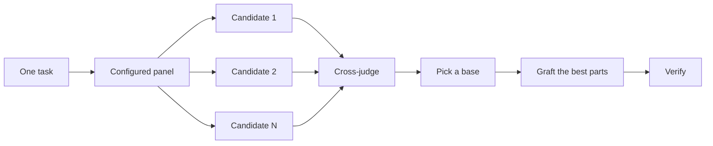

# 写代码之前先设计

对一个难设计只试一次，就会把模型想到的第一种形状锁死。`/architect` 在实现之前定下类型和边界。`/arena` 对同一份开工说明试几次，再合并最好的部分。`/interrogate` 让其他模型试着打破结果。工作是覆盖而不是综合出设计时，`/swarm` 把切片或竞速扇出去，再汇总结果。

最常见的两个设计错误，是收下 agent 的第一稿设计，以及打磨一份还没有任何代码检验过的计划。本页把两处都补上。你用代码来规划。原型回答未决问题，README 或教程定下目标，书面计划放在最后。


## 用 `/architect` 定下形状

```text
/architect design the import pipeline before writing any code. i care most about how callers use it.
```

[`/architect`](../../skills/architect/SKILL.md) 先把自己落在实处：追踪设计碰到的代码，涉及所有权或分层变动时跑 `/why`。然后跑 `/arena`，产出互相竞争的设计草图。每份草图先写调用方的用法，再是类型、签名和模块图。

默认情况下，它从综合后的设计直接进入实现。想先看设计，就说出来：

```text
/architect with checkpoint. stop and show me before implementing.
```

代码一开始，设计就不是神圣的。实现里如果在互不相关的地方出现同一个变通，或者类型只有靠 `any` 或强制转换才能编译，`/architect` 把这当作设计错了的证据。它丢掉草图重来，而不是绕着补。

## 用 `/arena` 把尝试扇出去

```text
/arena take my prompt to the arena verbatim. i want to compare their proposals with yours.
```

[`/arena`](../../skills/arena/SKILL.md) 是底下的通用工具。N 个 subagent 并行尝试同一份设计或代码开工说明，各自写到自己的 worktree 或目录。来自另一家模型厂商的只读裁判按评分标准给每个候选打分。没有另一家厂商的模型能跑时，协调者跳过裁判，自己选基座。协调者把每个候选从头读到尾，选定基座，把落选者里最好的想法嫁接进去，再验证结果。



小组来自你的 [`/setup-pstack`](../../skills/setup-pstack/SKILL.md) 配置，也可以按任务调整。决定要紧时多要几个候选，不要紧时少要：

```text
/arena this, 5 candidates. the cache key format is expensive to change later.
```

## 用 `/swarm` 覆盖切片和竞速

```text
/swarm check every package under packages/ against its check.sh. one worker per package. one report.
```

[`/swarm`](../../skills/swarm/SKILL.md) 把 N 个工作者扇到相互独立的切片、覆盖矩阵、挑战赛道、探索分区，或事先声明的竞速臂上。每个工作者有自己的范围和检查，然后报告 `PASS`、`ISSUES` 或 `BLOCKED`。父级等齐工作者，返回一份紧凑报告，带上缺口或掉队。

并行能买到覆盖，或能让独立检查互相竞速时，用它。`/arena` 给每个工作者同一份设计或代码开工说明，然后选基座并嫁接最好的部分。`/swarm` 覆盖切片，或按事先声明的选择规则跑一场竞速。它不用选基座和嫁接那套仪式。

## 用 `/interrogate` 打破它

```text
/interrogate the whole branch, but skeptically. no nitpicks unless it's an actual bug or regression.
```

[`/interrogate`](../../skills/interrogate/SKILL.md) 把改动和它的意图交给配置好的模型上的对手，每个对手都对着真实代码跑一次，试着打破它。对手会发现不同的失败。一条发现只有在重跑它的命令时仍显示破坏意图的失败，才留得下来。报告列出每条已验证的发现，以及发现它的对手，然后是每个对手丢掉了什么、为什么，并且什么都不应用。

也读 Dropped 清单。你可以推翻结论。

## 做原型，而不是辩论

绝不要收下第一份设计。要几份，再从你能看见的证据里挑：

```text
/poteto-mode prototype a few options for the new dropdown menu. take screenshots or videos for me to compare.
```

[原型 playbook](../../skills/poteto-mode/playbooks/prototype.md) 在临时目录里做一次性草图，把变体放在一个切换器后面，逐个驱动，并截图或计时。行为和算法也同样适用，不只是 UI。原型是用代码做的规划。它们让 agent 靠跑一个东西来回答自己的未决问题，而不是来问你，也给一个你想不到的选项留出位置。

同一个想法可以放大成真正的设计。把 `/architect` 和原型配在一起，并留一道评审门：

```text
/poteto-mode we need rate limiting for external webhooks. /architect it first, and answer open questions with prototypes. let me review before proceeding.
```

不要把对手花在抽象计划上。`/interrogate` 会丢掉一次运行证明不了的每条发现，所以背后没有代码的计划，没什么可打破的。让原型把问题定下来，再评审做出来的东西。

## 共享代码先写 README

包或 API 会被其他代码使用时，从用户会读的文档开始：

```text
/poteto-mode write a tutorial for how i would use the new config package first. then /teach me why it beats the current one.
```

先写教程，就会逼出调用方的视角。你向一个假设的用户描述 API，再倒推回实现。文档也变成 agent 核对自己工作的具体目标。文档本身要紧时，点名 [`/technical-writing`](../../skills/technical-writing/SKILL.md)，这样教程还是教程，不会一下子漂进参考和解释。

## 设计定了再写计划

pstack 故意没有规划 skill。你确实想要书面计划时，等设计定下来再要：

```text
/poteto-mode turn this design into a plan. small verifiable PRs, each with its own verification steps.
```

[多阶段计划 playbook](../../skills/poteto-mode/playbooks/multi-phase-plan.md) 用原型解决剩下的未决问题，然后每个 PR 写一节，每节以这次改动能用的证据收尾。光是一套通过的测试不算那种证据。计划就是交付物。playbook 不去实现它，并指出下一步跑哪个执行 playbook。

迁移时，在 prompt 里写明标准：

```text
/poteto-mode plan the migration of our ui library to the new styling system. small verifiable PRs, each with visual regression checks. the result must match the original exactly, bugs included.
```

「连 bug 一起」让迁移不会顺手悄悄修东西，否则新旧输出就没法对比。跨很多天的项目，可以把计划先 commit 进仓库一段时间，让其他 agent 看见还在做的工作。工作落地后删掉它。

## 一个任务配得上多少设计？

你也许在想，是不是每次改动都需要这些。不需要。大多数改动一样都不用。粗略的阶梯：

- 一处小的、已完成的改动，你没把握，只需要 `/interrogate`。
- 越过函数边界或移动所有权的改动，值得上 `/architect`，它会带上 `/arena`。
- 独立尝试会有帮助的单独决定，例如命名、格式或算法，直接用 `/arena`。
- 覆盖矩阵、一组并行检查，或带已声明臂的竞速，用 `/swarm`。
- 靠跑一个东西就能回答的未决问题，例如布局、耗时或一种做法，做原型，不要辩论。
- 推翻代价高的、有争议的设计，先 `/architect`，交付前再 `/interrogate`。
- 跨好几个 PR 的工作要一份计划，设计定了再写。

`/poteto-mode` 已经在用这架阶梯。越过边界的工作会自己触发 `/architect`，所以你直接去用这些，主要是想要比默认更多或更少的审视。

下一篇：[做出改动并清理](./05-build-and-clean.md)。
