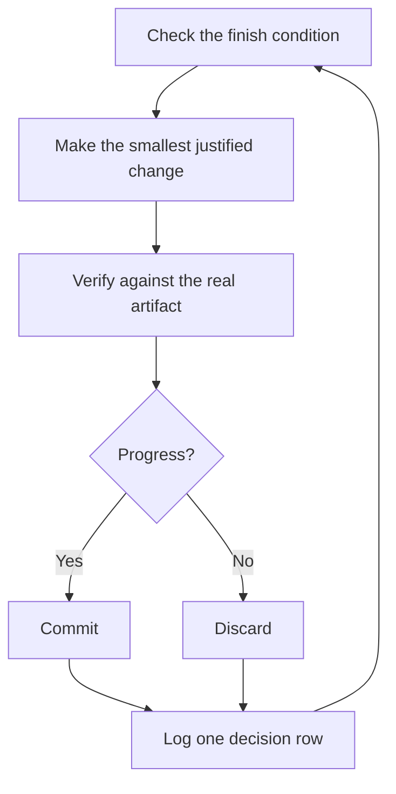

# 睡觉时让工作接着跑

这是前面一切的回报。你能信任它自己验证工作的 agent，就可以把一件难任务留给它。让这件事安全的，是可检查的完成条件、隔离的 worktree 或云 agent，以及一份你早上审计的决策日志。


## 先挣到信任，再开循环

你不信任的循环只是更快地生产没检查的工作，而且混乱随每次迭代叠加。留下一个循环跑之前，确认它已经挣到了：

- 你亲手做过一次这项任务，或看过 agent 做，所以你知道好是什么样。
- agent 有你自己会用的工具和信号：验证 skill、剖析器、日志。
- 每个阶段都证明自己的工作，工作没到标准时能停线。
- 你读过几份对话记录，并把反复的失败变成了工具、skill 或检查。

四条都成立之后，才让循环自主。在那之前，看着它跑。

## 过夜约定

一份好的交接有目标、完成条件、权限和一扇出口。不必很长：

```text
/poteto-mode im going to bed. migrate every caller to the new parser in a fresh worktree off <base>.
done means zero old callers, all parser fixtures pass, old api deleted.
keep a decision log. don't ask me before committing.
/loop until done. if you're truly stuck after a few hours, stop and write up why.
```

逐行走一遍每一行买到了什么：

- 「我去睡了」是会话级覆盖。agent 不再询问，继续往下。
- 「做完是指……」把目标变成每次迭代都能跑的检查。
- 「从 `<base>` 拉一个新 worktree」让这次运行不和你开着的其他东西相撞。
- 「commit 之前别问我」预先回答了 agent 否则会卡住的权限。
- `/loop` 是 Cursor 内置的唤醒机制，不是 pstack skill。[自主运行 playbook](../../skills/poteto-mode/playbooks/autonomous-run.md) 用它在事件或心跳上重新检查完成条件。
- 出口让它在真正的死胡同停下，并写下为什么。这胜过八小时创造性地重新解释目标。

因为你离开后才会审这份工作，`/poteto-mode` 把它交给 [`/figure-it-out`](../../skills/figure-it-out/SKILL.md)。后者在任何代码之前设计这次运行的阶段，并接上决策日志。

要有意停一次运行，告诉 agent 暂停，或告诉它你即将离线或重启 Cursor。[安全暂停 playbook](../../skills/poteto-mode/playbooks/pause-safely.md) 会做完或退出当前步骤，commit 一个做到一半的检查点，并写一份恢复说明。新聊天通过接手会话 playbook 从那份说明接上工作。说「继续」绝不会触发暂停。

## 循环整夜做什么



一次改动，一次检查，一行日志，每次迭代。没帮上忙的改动丢掉，不让它搭车留下。平台期意味着转向，不是停下。完成条件绝不会悄悄放宽来宣布胜利。

## 早晨的审计

[`/show-me-your-work`](../../skills/show-me-your-work/SKILL.md) 让这次运行可评审。每一行记录时间、阶段、决定、理由、一个证据指针和结果，TSV 放在 `decisions.tsv`（几次运行共用一个目录时是 `.audit/<task-slug>.tsv`）。默认留在本地。工作大到评审者需要这条痕迹才能信任结果时，再 commit 它。

你回来后，要一份评审形式的运行报告：

```text
/show-me-your-work catch me up on what you did last night
```

skill 交回摘要之前，会在另一个模型家族上启动一个评审者去读痕迹和对话记录，回复以 Attention 一节收尾，列出值得你审视的事。先读那一节，再读它指向的日志行。你在审计决定，不是把整夜重读一遍。

想要快速状态而不是审计，在跑过这份工作的聊天里跑 [`/ketchup`](../../skills/ketchup/SKILL.md)。它只读，用白话告诉你自你上一条消息以来变了什么，带上工作产出的截图和小图。然后列出每一件等你的调用，例如合并、批准，或在选项之间做选择，附上它的选择、证据和风险，这样你只凭回复就能决定。

## 夜里是一队列，不是一件任务

上面的约定把一件任务推到一个完成条件。有些夜里更多，一队列独立改动，或一整项程序。三个 playbook 把同样的信任放大。

[autopilot-full](../../skills/poteto-mode/playbooks/autopilot-full.md) 把一队列独立 PR 跑到已合并。每个 PR 有一个负责的 agent，从构建带到合并，没有任何负责人凭自己的结论合并。一群新的验证者组成的 swarm 检查负责人那份代码就绪的 head。之后的变基或小修复只派一个新的验证者，只有新行为或一大块新 diff 才再次叫来整个 swarm。只有对将要合并的那份补丁的干净结论，才授权合并：

```text
/poteto-mode full autopilot on this queue. each item is independent. i want them merged by morning.
```

[autopilot-stack](../../skills/poteto-mode/playbooks/autopilot-stack.md) 是不合并的 autopilot-full。你醒来看到已验证的 PR，每个都带结论，由你自己评审并落地。一个 PR 只叠在它所基于的那个 PR 上。想在任何东西合并前用自己的眼睛看过，就选它，而不是 autopilot-full：

```text
/poteto-mode autopilot these five changes, but don't merge. i'll land them in the morning.
```

[编排](../../skills/poteto-mode/playbooks/orchestrate.md) 用于活得比任何一个 agent 都长的程序：多日、许多叠着的 PR、在一个常驻协调聊天之下的成队 subagent。协调者决定哪台 agent 做哪一块工作，检查每台产出了什么，自己从不写代码。如果一台 agent 能在一个会话里做完，playbook 自己会把你送回上面的过夜约定：

```text
/poteto-mode orchestrate the store migration. own it until every package is converted and merged. i'll check in twice a day.
```

## 并行跑很多项目

[Cursor Project](https://cursor.com/blog/projects) 给一个协调 agent 一条持久线程。协调者不写代码。它指挥 subagent，默认在云里跑，所以笔记本合上工作仍继续。这就是编排 playbook 期望的形状。对协调者的 prompt 以 `/poteto-mode` 开头，它启动的 subagent 就遵循 playbook。

几条习惯有帮助：

- 每块工作自己一个 Project，例如一项功能、一次迁移、一次性能推进，或一次技术债清理。几个可以并排跑。
- 把相关聊天拖进 Project，包括已结束的。它们成为里面每个 agent 的上下文。
- 每个 PR 合并前给一个验证 swarm，让 autopilot-stack 或 autopilot-full 带走队列。
- 向协调者要一份有数据支撑的计划，并让它在问你之前用原型回答未决问题。

一条 prompt 可以承载整个 Project，从研究到执行：

```text
/poteto-mode refactor this repo so its architecture is more agent friendly. use /correct and /architect on past commits and review comments to find the mistakes agents make most here. use /recall for context from past chats. answer open questions with prototypes instead of asking me. come back with a plan backed by real data. once i approve it, run it with autopilot-stack or autopilot-full, and ask me which.
```

## 让循环自己启动

上面每个循环仍等你来启动。定时或事件驱动的自动化去掉这一步。软件维护拆成很适合这样做的阶段：分诊一份报告、复现它、修复它、验证修复。两条规则让这样一条线值得信任：

- 每个阶段都能停线。分诊可以判定报告是预期行为，复现可以复现失败，修复者可以判断改动风险太高。每一种结果都有用，因为它让坏工作到不了下一阶段，而下一阶段撤销的代价更高。
- 每个阶段都交出证据。复现附上坏状态的截图和视频，修复附上前后证据。人就可以在读一行代码之前，核对 agent 修对了东西。

pstack 把这做成一份休眠的[自动化包](../../automations/benny/README.md)，用于 Slack 的问题报告。一个自动化分诊每份报告。另一个复现已确认的 bug，并可能准备一份小的 draft 修复。把 agent 指向它的 [`FOR_AGENTS.md`](../../automations/benny/FOR_AGENTS.md)，并点名目标仓库来设置。

**坑：** 一段时间不是完成条件。「在这上面做 4 小时」没给 agent 任何可检查的东西，你会醒来看到四小时的动作，而不是一个结果。给 `/loop` 一个能过能败的谓词。

下一篇：[用原则的名字来驾驭](./08-principles.md)。
