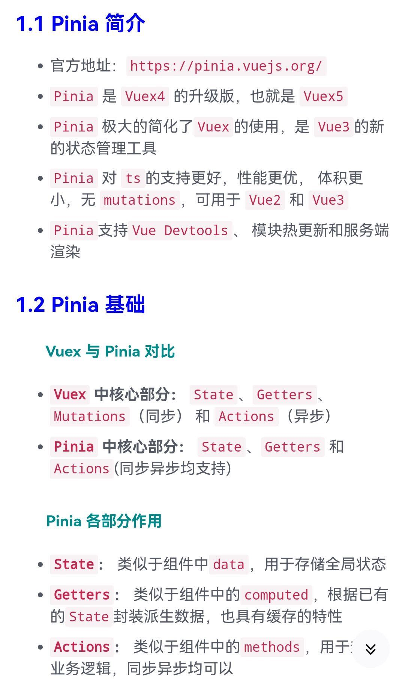

# Articles

- [Vue.js 技术揭秘](https://ustbhuangyi.github.io/vue-analysis/) 源码相关

# Config Docs

- [eslint-plugin-vue](https://eslint.vuejs.org/)

# Vue 2 Ecosystem Docs

- vue 2 https://v2.cn.vuejs.org/
- vuex 3.x https://v3.vuex.vuejs.org/zh/
- Vue Router 3 https://v3.router.vuejs.org/zh/
- @vue/cli https://cli.vuejs.org/zh/
- VS Code plugin [Vetur](https://marketplace.visualstudio.com/items?itemName=octref.vetur)

# Vue 3 Ecosystem Docs

- vue 3 https://cn.vuejs.org/
- module bundler: Vite https://cn.vitejs.dev/

使用 Vue CLI 构建的项目仍然使用 Webpack 进行打包，使用 Vite 需要使用构建工具

- Pinia
- Vue Router 4 https://router.vuejs.org/
- @vue/cli https://cli.vuejs.org/zh/
- VS Code plugin [Volar](https://marketplace.visualstudio.com/items?itemName=Vue.volar)

**Vue CLI 现已处于维护模式!**

现在官方推荐使用 [`create-vue`](https://github.com/vuejs/create-vue) 来创建基于 [Vite](https://cn.vitejs.dev/) 的新项目。另外请参考 [Vue 3 工具链指南](https://cn.vuejs.org/guide/scaling-up/tooling.html) 以了解最新的工具推荐。

# Problems

- `watchEffect()` 和 `watch(sources, callback, immediate)` 有什么区别？
- watch 监听两次输出的 oldV 一样，newV 也一样，明明只变化了一次，为何会激发 watch 函数两次。
- 如何查看确定当前项目构建时使用的 @vue/cli 或者 vue-cli 版本。
- runtime-only build, template compiler, pre-compile, render functions, compiler-included build
  > vue.runtime.esm.js?ff9b:619: [Vue warn]: You are using the runtime-only build of Vue where the template compiler is not available. Either pre-compile the templates into render functions, or use the compiler-included build.

原因分析

在项目配置的时候，默认 npm 包导出的是运行时构建，即 runtime 版本，不支持编译 template 模板。

版本区别

[[Vue.js] 对不同构建版本的解释](https://cn.vuejs.org/v2/guide/installation.html#%E5%AF%B9%E4%B8%8D%E5%90%8C%E6%9E%84%E5%BB%BA%E7%89%88%E6%9C%AC%E7%9A%84%E8%A7%A3%E9%87%8A)

- Compiler 版本

  可以对 template 模板内容进行编译（包括字符串模板和可以绑定的 html 对象作为模板）。

- Runtime 版本

  使用 vue-loader 加载 .vue 文件（组件文件）时，webpack 在打包过程中对模板进行了渲染。

由于使用包含运行时编译器的 Vue 构建版本会让应用额外增加 10kb 左右 → [vue.config.js - runtimeCompiler](https://cli.vuejs.org/zh/config/index.html#runtimecompiler)

采用在 render 函数内预编译模板（不需要编译器）的方式是更好的选择 → [[Vue.js] 运行时 + 编译器 vs. 只包含运行时](https://cn.vuejs.org/v2/guide/installation.html#%E8%BF%90%E8%A1%8C%E6%97%B6-%E7%BC%96%E8%AF%91%E5%99%A8-vs-%E5%8F%AA%E5%8C%85%E5%90%AB%E8%BF%90%E8%A1%8C%E6%97%B6)

解决方法

使用 render 函数预编译。

…TODO

REFS

- [[CSDN] vue 报错 You are using the runtime-only build…](https://blog.csdn.net/C_ZhangSir/article/details/100989902)
  - [[CSDN] [Vue warn]: You are using the runtime-only build…](https://blog.csdn.net/xiaomajia029/article/details/88320233)
  - [Writing multiple Vue components in a single file](https://codewithhugo.com/writing-multiple-vue-components-in-a-single-file/)

# Others

可使用 Pinia 替代 Vuex。

- vite
- 静态资源存储

@vue/cli 开始，在 `<projectRoot>/public` 下存储。vue-cli 时，使用的是 `<projectRoot>/static`。

- [[Vue CLI DOC] 处理静态资源](https://cli.vuejs.org/zh/guide/html-and-static-assets.html#%E5%A4%84%E7%90%86%E9%9D%99%E6%80%81%E8%B5%84%E6%BA%90)

# 相关

- [Webpack](/Node/Build-Tool/Webpack.md)
- [ESLint](/Language/JavaScript/ESLint.md)
- [vue在组件销毁的时候将异步请求撤销](/Blog/vue在组件销毁的时候将异步请求撤销.md)
- [版本查看](/Node/Node.md)
